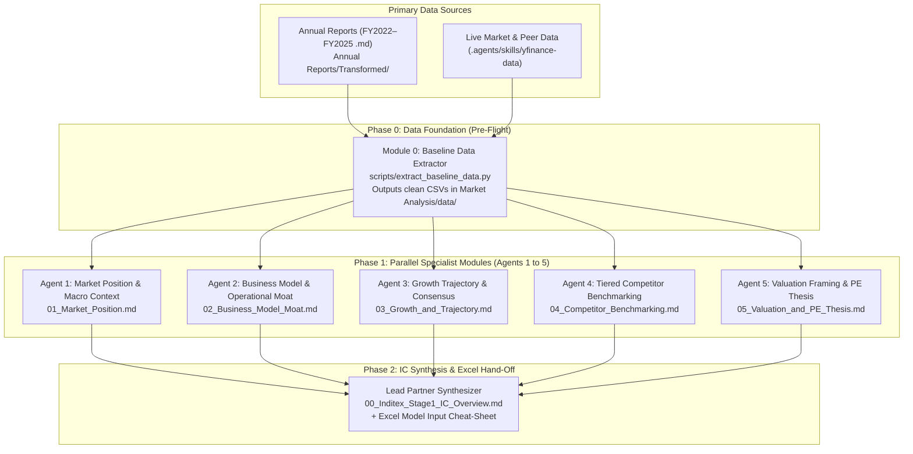

# Inditex (ITX.MC) — Stage 1 PE & Market Analysis: Multi-Agent Execution Plan

> [!IMPORTANT]
> **Scope & Boundary Guardrails (Read First)**
> - **Role & Perspective**: Senior Private Equity Partner (+20 years LBO structuring and retail/consumer sector experience).
> - **Purpose**: Deliver a strategic, operational, and market-based **starting point** for an Inditex LBO case study.
> - **Strict Exclusions**: **DO NOT** build debt structures (no Senior/Mezzanine tranches, interest rates, debt service schedules, or covenant models) and **DO NOT** build full 3-statement projections or granular DCF/LBO financial models. The user will build all concrete financial models and debt structures in Excel in Stage 2.
> - **Deliverable Language**: English (all code, comments, data tables, and Markdown reports).

---

## 1. System Architecture & Multi-Agent Workflow

This plan is designed for parallel execution by a team of specialized agents (e.g., via `/teamwork-preview` or `invoke_subagent`) or sequential modular execution by a single agent. Each module has **zero overlap**, explicit **data inputs** (with exact line anchors in [`Annual Reports/Transformed/`](file:///d:/Escritorio/MEFI/Asignaturas/Módulo%201/Corporate%20Finance/Inditex%20LBO/Annual%20Reports/Transformed)), assigned **skills** from [`.agents/skills/`](file:///d:/Escritorio/MEFI/Asignaturas/Módulo%201/Corporate%20Finance/Inditex%20LBO/.agents/skills), and a dedicated **Markdown output file**.



---

## 2. Directory Structure to Generate

All outputs must be written inside [`Market Analysis/`](file:///d:/Escritorio/MEFI/Asignaturas/Módulo%201/Corporate%20Finance/Inditex%20LBO/Market%20Analysis):

```text
Market Analysis/
├── STAGE_1_EXECUTION_PLAN.md              # This master blueprint
├── 00_Inditex_Stage1_IC_Overview.md       # Master synthesized IC report + Excel Starting-Point Cheat Sheet
├── modules/
│   ├── 01_Market_Position.md              # Output of Agent 1
│   ├── 02_Business_Model_Moat.md          # Output of Agent 2
│   ├── 03_Growth_and_Trajectory.md        # Output of Agent 3
│   ├── 04_Competitor_Benchmarking.md      # Output of Agent 4
│   └── 05_Valuation_and_PE_Thesis.md      # Output of Agent 5
├── data/
│   ├── inditex_kpis_2022_2025.csv         # High-level multi-year KPIs extracted from Annual Reports
│   ├── inditex_brands_breakdown.csv       # Sales, stores, and ROCE by brand concept (FY22–FY25)
│   ├── peer_benchmarking_table.csv        # Live peer multiples & operating margins via yfinance
│   └── analyst_consensus_summary.csv      # Forward revenue/EPS consensus & revisions via estimate-analysis
└── scripts/
    └── extract_baseline_data.py           # Reproducible data extraction script (Annual Reports + yfinance)
```

---

## 3. Exact Line-Number Map for [`Annual Reports/Transformed/`](file:///d:/Escritorio/MEFI/Asignaturas/Módulo%201/Corporate%20Finance/Inditex%20LBO/Annual%20Reports/Transformed)

> [!CAUTION]
> **Context Window Protection Rule for Agents**
> Each transformed report is **~2.0–2.4 MB (~42,000 lines)** and is in **Spanish** (note: Inditex's FY2025 runs from Feb 1, 2025 to Jan 31, 2026). **NEVER read an entire report file at once.** Always use `view_file` with `StartLine` and `EndLine` (max 300–500 lines per call) using the exact line map below, or use Python scripts to parse specific tables.

| Section / Topic (Spanish Title in File) | [`ConsolidatedReport_2022.md`](file:///d:/Escritorio/MEFI/Asignaturas/Módulo%201/Corporate%20Finance/Inditex%20LBO/Annual%20Reports/Transformed/ConsolidatedReport_2022.md) | [`ConsolidatedReport_2023.md`](file:///d:/Escritorio/MEFI/Asignaturas/Módulo%201/Corporate%20Finance/Inditex%20LBO/Annual%20Reports/Transformed/ConsolidatedReport_2023.md) | [`ConsolidatedReport_2024.md`](file:///d:/Escritorio/MEFI/Asignaturas/Módulo%201/Corporate%20Finance/Inditex%20LBO/Annual%20Reports/Transformed/ConsolidatedReport_2024.md) | [`ConsolidatedReport_2025.md`](file:///d:/Escritorio/MEFI/Asignaturas/Módulo%201/Corporate%20Finance/Inditex%20LBO/Annual%20Reports/Transformed/ConsolidatedReport_2025.md) |
| :--- | :--- | :--- | :--- | :--- |
| **Consolidated Financial Statements** (*Cuentas Anuales: PyG, Balance, Flujos*) | `L170–L500` | `L180–L500` | `L170–L500` | `L170–L500` |
| **Note 4: Net Sales Breakdown** (*Nota 4. Ventas — by format, channel, geography*) | `L3830–L3920` | `L3310–L3400` | `L3470–L3560` | `L3525–L3610` |
| **Note 11: Segment Reporting & ROCE** (*Nota 11. Información por segmentos — Zara vs. Rest, ROCE*) | `L4195–L4350` | `L3665–L3820` | `L3820–L3980` | `L3845–L4010` |
| **Note 16: Leases / IFRS 16 Context** (*Nota 16. Arrendamientos*) | `L4670–L4820` | `L4120–L4270` | `L4280–L4430` | `L4315–L4460` |
| **Note 21: Net Cash Position** (*Nota 21. Posición financiera neta*) | `L5020–L5120` | `L4465–L4560` | `L4615–L4710` | `L4660–L4760` |
| **Consolidated Management Report** (*Informe de Gestión Consolidado — KPIs, stores, online, capex*) | `L7900–L9400` | `L7375–L9050` | `L7410–L9100` | `L7485–L9200` |
| **CEO/Chair Letters & Key Figures** (*Carta Presidente/CEO, Inditex de un vistazo, Datos clave*) | `L9400–L10500` | `L9070–L10450` | `L9100–L10200` | `L9250–L9600` |
| **Corporate Governance & Major Shareholders** (*IAGC — Section A.2 Titulares directos/indirectos*) | `L34130–L34300` | `L33790–L33950` | `L33915–L34080` | `L34000–L34300` |

---

## 4. Detailed Workstream Specifications

### Module 0: Baseline Data Extraction & Hygiene (Pre-Flight Task)
- **Assigned Agent**: Data Engineering / Lead Agent (runs first before parallel agents, or runs as Step 1).
- **Skills Used**:
  - [`yfinance-data`](file:///d:/Escritorio/MEFI/Asignaturas/Módulo%201/Corporate%20Finance/Inditex%20LBO/.agents/skills/yfinance-data/SKILL.md)
  - [`estimate-analysis`](file:///d:/Escritorio/MEFI/Asignaturas/Módulo%201/Corporate%20Finance/Inditex%20LBO/.agents/skills/estimate-analysis/SKILL.md)
- **Concrete Tasks**:
  1. Write and execute `Market Analysis/scripts/extract_baseline_data.py` to query `yfinance` for:
     - **Target**: `ITX.MC` (Industria de Diseño Textil, S.A.)
     - **Tier 1 Core Apparel/Fast Fashion Peers**: `HM-B.ST` (H&M), `9983.T` (Fast Retailing / Uniqlo), `NXT.L` (Next plc), `GAP` (Gap Inc.), `ABF.L` (Associated British Foods / Primark).
     - **Tier 3 Premium/Lifestyle Benchmarks**: `LULU` (Lululemon), `ADS.DE` (Adidas), `NKE` (Nike).
  2. Extract high-level market snapshot metrics (Market Cap, Enterprise Value, Current Share Price, 52-week range, Beta, LTM Revenue, Gross Margin %, EBITDA Margin %, Operating/EBIT Margin %, Trailing & Forward P/E, EV/EBITDA, EV/Revenue, Dividend Yield) into `Market Analysis/data/peer_benchmarking_table.csv`.
  3. Extract forward consensus estimates (`0y`, `+1y` revenue & EPS growth, analyst target price range) for `ITX.MC` into `Market Analysis/data/analyst_consensus_summary.csv`.
  4. Extract the multi-year headline summary table (FY2022, FY2023, FY2024, FY2025) from [`ConsolidatedReport_2025.md`](file:///d:/Escritorio/MEFI/Asignaturas/Módulo%201/Corporate%20Finance/Inditex%20LBO/Annual%20Reports/Transformed/ConsolidatedReport_2025.md) (`L7485–L9550`, `L3525–L4010`, `L4660–L4760`) and [`ConsolidatedReport_2023.md`](file:///d:/Escritorio/MEFI/Asignaturas/Módulo%201/Corporate%20Finance/Inditex%20LBO/Annual%20Reports/Transformed/ConsolidatedReport_2023.md) (for FY22/23 comparisons) into `Market Analysis/data/inditex_kpis_2022_2025.csv` and `Market Analysis/data/inditex_brands_breakdown.csv`.
- **Verification**: Confirm all 4 CSV files exist in `Market Analysis/data/` and contain non-null figures.

---

### Module 1: Inditex Market Position & Industry Landscape
- **Assigned Agent**: Agent 1 (`Market & Macro Strategist`)
- **Output File**: `Market Analysis/modules/01_Market_Position.md`
- **Skills Used**: [`yfinance-data`](file:///d:/Escritorio/MEFI/Asignaturas/Módulo%201/Corporate%20Finance/Inditex%20LBO/.agents/skills/yfinance-data/SKILL.md)
- **Primary Sources**:
  - [`ConsolidatedReport_2025.md`](file:///d:/Escritorio/MEFI/Asignaturas/Módulo%201/Corporate%20Finance/Inditex%20LBO/Annual%20Reports/Transformed/ConsolidatedReport_2025.md) (`L3525–L3610` Note 4 Sales by Geography; `L7485–L8200` Management Report; `L9250–L9600` Chair/CEO Letters & Key Figures 2025).
  - [`ConsolidatedReport_2024.md`](file:///d:/Escritorio/MEFI/Asignaturas/Módulo%201/Corporate%20Finance/Inditex%20LBO/Annual%20Reports/Transformed/ConsolidatedReport_2024.md) (`L7410–L8100`).
- **Concrete Aspects to Cover**:
  1. **Global Apparel Positioning**: Where Inditex sits in the global fashion ecosystem (~€39.9B FY25 revenue across 90+ physical markets and 200+ online markets) — the "sweet spot" combining mass scale with aspirational brand perception ("masstige" / elevated fast fashion).
  2. **Geographic Footprint & Diversification (FY2022–FY2025)**:
     - Breakdown of sales across **Spain**, **Rest of Europe**, **Americas**, and **Asia & Rest of World**.
     - Strategic shift: Reducing reliance on domestic Spain (which has steadily grown in absolute terms while Americas and Europe ex-Spain drive international expansion) and identifying white-space markets (specifically the **United States**, Inditex's #2 market, where penetration remains low relative to Europe).
  3. **Macro & Sector Tailwinds/Headwinds for a PE Sponsor**:
     - Consumer resilience in "accessible aspirational" apparel vs. luxury slowdown.
     - FX exposure (EUR reporting vs. USD, MXN, JPY, GBP, TRY basket — highlighted by FY25 +3.2% reported vs. +7.0% constant currency growth).
     - Regulatory & ESG landscape in Europe (EU Strategy for Sustainable and Circular Textiles, eco-design requirements covered in the Annual Report sustainability chapters).

---

### Module 2: Business Model Anatomy & Operational Moat ("The Inditex Machine")
- **Assigned Agent**: Agent 2 (`Operations & Business Model Specialist`)
- **Output File**: `Market Analysis/modules/02_Business_Model_Moat.md`
- **Skills Used**: No external API required; deep qualitative and KPI synthesis from Annual Reports.
- **Primary Sources**:
  - [`ConsolidatedReport_2025.md`](file:///d:/Escritorio/MEFI/Asignaturas/Módulo%201/Corporate%20Finance/Inditex%20LBO/Annual%20Reports/Transformed/ConsolidatedReport_2025.md) & [`ConsolidatedReport_2024.md`](file:///d:/Escritorio/MEFI/Asignaturas/Módulo%201/Corporate%20Finance/Inditex%20LBO/Annual%20Reports/Transformed/ConsolidatedReport_2024.md) (`Informe de Gestión Consolidado`, `Nota 11. Información por segmentos`, `Nota 4. Ventas`).
- **Concrete Aspects to Cover**:
  1. **The Demand-Pull ("Pull" vs. "Push") Supply Chain Moat**:
     - How Inditex keeps a high share of manufacturing in proximity hubs (Spain, Portugal, Morocco, Turkey) with centralized logistics in Spain (Arteixo, Zaragoza, Meco, León, plus the new Zaragoza II / logistics expansion plan).
     - **Why this matters for PE**: In-season flexibility (2–3 week design-to-rack cycle), minimal inventory obsolescence risk, industry-low markdown ratios, and structural gross margin protection (~58%).
  2. **Integrated Omnichannel & Store Optimization Program**:
     - Evolution of physical store count vs. total selling area (fewer, larger, higher-productivity flagship stores with 400+ annual store interventions: openings, enlargements, refurbishments).
     - Technological moat: Next-generation RFID / soft-tag security and self-checkout, integrated stockrooms (single inventory pool serving both walk-in customers and online orders).
     - Online sales trajectory and economics (online vs. physical store synergy rather than cannibalization).
  3. **Negative Operating Working Capital Engine (Conceptual & Strategic View)**:
     - Explain the structural cash conversion cycle advantage: Immediate cash collection from retail consumers vs. trade payable terms with suppliers, supplemented by tight inventory turns. Explain why this allows Inditex to self-fund Capex and grow without consuming cash (a premier LBO trait).
  4. **Brand Portfolio Architecture & Capital Allocation (Concept-by-Concept)**:
     - **Zara & Zara Home** (the core flagship engine, ~72% of revenue) vs. **Pull&Bear**, **Massimo Dutti**, **Bershka**, **Stradivarius**, and **Oysho**.
     - Compare each brand's target demographic, price/fashion positioning, store count evolution, sales share, and **Return on Capital Employed (ROCE)** (citing Note 11 segment ROCE: e.g., Zara ~36%, Rest of Formats ~45–50%, Total ~40%).

---

### Module 3: Historical Growth Trajectory & Consensus Outlook
- **Assigned Agent**: Agent 3 (`Financial Trajectory & Consensus Analyst`)
- **Output File**: `Market Analysis/modules/03_Growth_and_Trajectory.md`
- **Skills Used**:
  - [`earnings-recap`](file:///d:/Escritorio/MEFI/Asignaturas/Módulo%201/Corporate%20Finance/Inditex%20LBO/.agents/skills/earnings-recap/SKILL.md)
  - [`estimate-analysis`](file:///d:/Escritorio/MEFI/Asignaturas/Módulo%201/Corporate%20Finance/Inditex%20LBO/.agents/skills/estimate-analysis/SKILL.md)
- **Primary Sources**:
  - `Market Analysis/data/inditex_kpis_2022_2025.csv` & `Market Analysis/data/analyst_consensus_summary.csv`.
  - [`ConsolidatedReport_2022.md`](file:///d:/Escritorio/MEFI/Asignaturas/Módulo%201/Corporate%20Finance/Inditex%20LBO/Annual%20Reports/Transformed/ConsolidatedReport_2022.md) through [`ConsolidatedReport_2025.md`](file:///d:/Escritorio/MEFI/Asignaturas/Módulo%201/Corporate%20Finance/Inditex%20LBO/Annual%20Reports/Transformed/ConsolidatedReport_2025.md) (`Informe de Gestión Consolidado` & `Nota 21 Posición financiera neta`).
- **Concrete Aspects to Cover** *(High-level trajectory to inform the user's future Excel assumptions — no full 3-statement modeling)*:
  1. **Post-Pandemic Compounding Track Record (FY2022–FY2025)**:
     - Summary table of headline metrics across FY22, FY23, FY24, and FY25: Net Sales (€M and YoY % in reported and constant currency), Gross Profit & Gross Margin %, EBITDA & EBITDA Margin %, EBIT & EBIT Margin %, Net Income, Net Cash Position, and Dividends per Share.
  2. **Operating Leverage & Margin Quality**:
     - How Inditex expanded Gross Margin to 58.3% in FY25 while keeping OpEx growth (2.8% in FY25) below top-line growth (3.2% reported / 7.0% constant currency).
     - Brief, crystal-clear note on **Lease Accounting (IFRS 16)** from `Nota 16` so the user knows the approximate magnitude of lease liabilities and annual lease payments when they build their Excel model later.
  3. **Capex Cycle & Cash Conversion**:
     - Ordinary Capex vs. Extraordinary Logistics Capex program (€900M/year logistics expansion plan in 2024–2025) and how the Net Cash pile evolved alongside rising dividend payouts (€1.75/share in FY25).
  4. **Forward Street Consensus & Growth Drivers (`estimate-analysis` & `earnings-recap`)**:
     - What sell-side consensus expects for the next 1–2 fiscal years (revenue growth, EPS trajectory, revision momentum, bull vs. bear spread).
     - **Guidance for the User's Excel Model**: Recommended Base, Bull, and Bear case growth and margin assumption ranges derived from historical performance and street consensus.

---

### Module 4: Tiered Competitor Analysis & Benchmarking
- **Assigned Agent**: Agent 4 (`Competitive Intelligence & Comps Specialist`)
- **Output File**: `Market Analysis/modules/04_Competitor_Benchmarking.md`
- **Skills Used**:
  - [`yfinance-data`](file:///d:/Escritorio/MEFI/Asignaturas/Módulo%201/Corporate%20Finance/Inditex%20LBO/.agents/skills/yfinance-data/SKILL.md)
  - [`stock-correlation`](file:///d:/Escritorio/MEFI/Asignaturas/Módulo%201/Corporate%20Finance/Inditex%20LBO/.agents/skills/stock-correlation/SKILL.md)
- **Primary Sources**:
  - `Market Analysis/data/peer_benchmarking_table.csv`
  - Web research (if needed) for private/non-listed benchmarks (Shein, Mango).
- **Concrete Aspects to Cover**:
  1. **Tiered Competitor Framework**:
     - **Tier 1 — Core Global Apparel & Fast Fashion**: **H&M** (`HM-B.ST`), **Fast Retailing / Uniqlo** (`9983.T`), **Next plc** (`NXT.L`), **Gap Inc.** (`GAP`), **Associated British Foods / Primark** (`ABF.L`).
     - **Tier 2 — Digital Disruptors & Regional Peers (Qualitative & Reported Benchmarks)**: **Shein** (ultra-low-cost, China-direct micro-batch model) and **Mango** (Spanish peer executing store/brand elevation).
     - **Tier 3 — Global Premium & Athletic Leaders**: **Lululemon** (`LULU`), **Adidas** (`ADS.DE`), **Nike** (`NKE`).
  2. **Operational & Profitability Comparison Table**:
     - Compare Scale (Revenue), Revenue Growth, Gross Margin %, EBITDA Margin %, EBIT Margin %, Inventory Efficiency / Working Capital profile, and Return on Capital across the peer tiers.
  3. **Strategic Competitive Assessment ("Why Inditex Wins")**:
     - *Inditex vs. H&M*: Why Inditex's proximity sourcing and brand elevation opened a massive margin and ROIC gap over H&M's Asian-sourced model.
     - *Inditex vs. Uniqlo (Fast Retailing)*: Fashion-forward rapid rotation (Zara) vs. functional basics/LifeWear (Uniqlo) — the two clear winners in global apparel.
     - *Inditex vs. Shein*: Why Zara insulated itself from Shein by moving upmarket in quality, store experience, and design rather than competing on €5 price points.
  4. **Market Co-Movement & Risk Profile (`stock-correlation`)**:
     - Empirical correlation and beta comparison showing how public equity markets price Inditex relative to European retail vs. premium consumer compounders.

---

### Module 5: High-Level Business Valuation & PE LBO "Starting Point"
- **Assigned Agent**: Agent 5 (`PE Valuation & Deal Framing Lead`)
- **Output File**: `Market Analysis/modules/05_Valuation_and_PE_Thesis.md`
- **Skills Used**:
  - [`company-valuation`](file:///d:/Escritorio/MEFI/Asignaturas/Módulo%201/Corporate%20Finance/Inditex%20LBO/.agents/skills/company-valuation/SKILL.md) *(used for market multiple benchmarking, WACC parameter discovery, and high-level conceptual triangulation — NOT for building a granular spreadsheet)*
  - [`stock-liquidity`](file:///d:/Escritorio/MEFI/Asignaturas/Módulo%201/Corporate%20Finance/Inditex%20LBO/.agents/skills/stock-liquidity/SKILL.md)
- **Primary Sources**:
  - `Market Analysis/data/peer_benchmarking_table.csv`
  - [`ConsolidatedReport_2025.md`](file:///d:/Escritorio/MEFI/Asignaturas/Módulo%201/Corporate%20Finance/Inditex%20LBO/Annual%20Reports/Transformed/ConsolidatedReport_2025.md) (`L3845–L4010` Note 11 Segments; `L4660–L4760` Note 21 Net Cash; `L34000–L34300` IAGC Shareholder Structure).
- **Concrete Aspects to Cover** *(Strictly high-level valuation context & strategic LBO framing — NO debt tranches or concrete financial projections)*:
  1. **Current Market Valuation Snapshot**:
     - Inditex's current Market Cap, Net Cash bridge to Enterprise Value (EV), and current trading multiples (`EV/EBITDA`, `EV/EBIT`, `P/E`, `FCF Yield`, `Dividend Yield`).
  2. **Relative Valuation & Multiple Premium Justification**:
     - How Inditex trades vs. Tier 1 Apparel medians and Tier 3 Premium medians.
     - Why Inditex commands a structural valuation premium (superior ROCE ~40%, negative working capital, net cash fortress, consistent compounding) and whether current multiples represent historical highs, fair value, or compression risk.
  3. **Conceptual Sum-of-the-Parts (SOTP) Lens**:
     - How a PE buyer evaluates the portfolio: **Zara / Zara Home** (core crown jewel) vs. the **High-ROCE Younger Concepts** (Bershka, Stradivarius, Pull&Bear, Massimo Dutti, Oysho — which actually generate 45%–50% ROCE in Note 11!) + **Net Cash**. Discuss potential portfolio optionality (e.g., spin-off or standalone valuation of non-Zara brands).
  4. **Valuation Parameters for the User's Upcoming Excel Model**:
     - Provide clean reference benchmarks for **Cost of Capital (WACC inputs)**: Risk-free rate, Inditex levered/unlevered Beta, Equity Risk Premium, and peer multiple ranges (`EV/EBITDA` and `P/E` exit multiple bands) so the user can plug them straight into Excel.
  5. **High-Level PE / LBO "Starting Point" Thesis & Ownership Reality**:
     - **Ownership & Control Analysis (from IAGC)**: Amancio Ortega Gaona (via **Pontegadea Inversiones, S.L.** and **Partler Participaciones, S.L.U.** = **59.294%**) + Sandra Ortega Mera (via **Rosp Corunna** = **5.053%**) = **64.35% family ownership**, leaving **~35.65% free float** (`stock-liquidity` check on trading volume and float).
     - **Strategic LBO Framing**:
       - *What makes Inditex an "LBO Dream" operationally*: ~58% gross margins, ~40% ROCE, massive cash conversion, negative working capital, and a ~€11B+ net cash balance sheet with virtually zero financial debt.
       - *What makes Inditex a "Mega-Cap Challenge" structurally*: €150B+ market cap and >59% majority control by Pontegadea — meaning any realistic LBO in an academic or real-world case is framed either as a **Family/Pontegadea Take-Private Consortium (buying out the ~35.7% minority free float)** or a **Theoretical 100% Buyout / Carve-Out Case Study**.
       - *Key Value-Creation Levers & Risks to Model in Excel*: (1) US & international store expansion, (2) Operating margin expansion post-logistics Capex peak, (3) Balance sheet optimization (deploying excess net cash and re-levering a zero-debt company), and (4) Key downside risks (fashion miss, FX headwinds, entry multiple compression).

---

### Phase 2: Master Synthesis & Excel Hand-Off Deliverable
- **Assigned Agent**: Lead PE Partner Synthesizer
- **Output File**: `Market Analysis/00_Inditex_Stage1_IC_Overview.md`
- **Concrete Tasks**:
  1. Synthesize Modules 1–5 into a cohesive, executive-ready **Stage 1 Investment Committee (IC) Screening Report** in [`Market Analysis/00_Inditex_Stage1_IC_Overview.md`](file:///d:/Escritorio/MEFI/Asignaturas/Módulo%201/Corporate%20Finance/Inditex%20LBO/Market%20Analysis/00_Inditex_Stage1_IC_Overview.md) with cross-links to the 5 detailed modular files in `Market Analysis/modules/` and the CSV datasets in `Market Analysis/data/`.
  2. Include a dedicated final section: **"Section 6: Excel Modeling Starting-Point Kit (Key Baseline Inputs & Assumptions)"** summarizing in one clean table:
     - Historical baseline anchor figures (FY2022–FY2025).
     - Suggested Base / Bull / Bear operating driver ranges (Revenue growth %, Gross Margin %, EBITDA/EBIT Margin %, Capex % of sales, Working Capital % of sales).
     - Suggested Valuation & Exit Multiple ranges (`EV/EBITDA`, `EV/EBIT`, `P/E`, `WACC` components, Terminal Growth `g`).

---

## 5. Execution Instructions for the Agent / Team of Agents

1. **Step 1 (Data Extraction)**: Run **Module 0** first to generate all 4 CSVs in `Market Analysis/data/`.
2. **Step 2 (Parallel Module Execution)**: Spawn 5 subagents (using `invoke_subagent` with `TypeName: "self"` or via `/teamwork-preview`) — one each for **Modules 1, 2, 3, 4, and 5** — passing each agent its specific module instructions, exact line anchors from Section 3, and the path to `Market Analysis/data/`.
3. **Step 3 (Master IC Synthesis)**: Once all 5 module files in `Market Analysis/modules/` are complete, execute **Phase 2** to compile `Market Analysis/00_Inditex_Stage1_IC_Overview.md`.
4. **Quality Check**: Verify that no debt tranche schedules or granular 3-statement Excel projections were included, that all FY2022–FY2025 figures match Inditex's Consolidated Annual Reports, and that all file links and CSV tables are clean.

