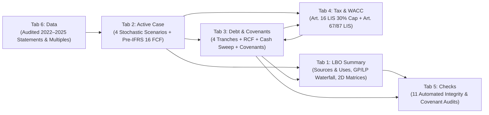

# Inditex LBO — Institutional Buyout Model & Due Diligence (`Project Galicia`)

> **Primary Deliverable 1 (Definitive Financial Model):** [`Inditex_LBO_Version_Definitiva.xlsx`](Inditex_LBO_Version_Definitiva.xlsx)
> **Primary Deliverable 2 (Executive IC Presentation Deck):** [`Project_Galicia_LBO_Inditex.pdf`](Project_Galicia_LBO_Inditex.pdf)
> **Interactive LBO & Value-Creation Levers Dashboard:** [`Business Plan/output/Dashboard_palancas.html`](Business%20Plan/output/Dashboard_palancas.html)
> **Transaction Subject:** Industria de Diseño Textil, S.A. (`BME: ITX`) — FY2025 Audited Baseline (`€39,864m` Revenue, `€11,243m` Pre-IFRS 16 Cash EBITDA)
> **Model Horizon:** 7-Year Holding Period (`FY2026E–FY2032E`, with 5-Year Calibration Anchor at `FY2030E`)
> **Audit Integrity Status:** `11 / 11 OK` Automated Model Integrity & Covenant Checks in Base (`P50`), Bull (`P80`), and Bear (`P20`) Cases

---

## 1. Executive Summary & Transaction Thesis

This repository contains the end-to-end **Institutional Leveraged Buyout (LBO) Model**, **Commercial & Strategic Due Diligence (Stage 1 IC Package)**, **Historical Accounting & Cash Conversion Analysis**, and **Econometric / Monte Carlo Business Plan Calibration** for a simulated take-private of **Industria de Diseño Textil, S.A. (Inditex / `BME: ITX`)**.

Because Inditex's unadjusted market capitalization (`€172,725m` at `€55.42/share`) makes a traditional 100% third-party buyout infeasible within European leveraged loan and private equity fund concentration limits, the transaction is structured as a **Consortium Co-Investment & Majority Family Rollover Buyout (`Project Galicia`)**:

- **Offer Valuation & Entry Perimeter:** Voluntary delisting tender offer (*OPA de exclusión*) at **`€66.50 / share`** (`20.0%` takeover premium over the `€55.42` undisturbed spot price), implying an **Offer Equity Value of `€207,258.2m`** and an **Entry Enterprise Value of `€199,729.2m`** (`14.0x` 2026E Reported EBITDA / `16.5x` 2026E Pre-IFRS 16 Cash EBITDA), net of **`€9,029.0m` Sweepable Cash** (retaining a **`€2,226.0m` Locked Operational Cash Box** inside OpCo to fund intra-season working capital swings).
- **Ortega / Pontegadea Equity Rollover (`25.0%`):** Amancio Ortega (`59.294%` pre-deal stake via Pontegadea Inversiones, S.L. and Partler 2006, S.L.) rolls **`25.0%` of the Offer Equity Value (`€51,814.6m`)** into TopCo under the Spanish special tax-neutrality regime (*Régimen FEAC*, Art. 87 LIS) and cashes out `€71,077.5m` gross at closing.
- **Sponsor Consortium & GP/LP Waterfall (`80% / 20%`):** The **`€89,386.1m` Sponsor Cash Equity Pool** is syndicated across **`20.0%` Lead GP Capital (`€17,877.2m`)** and **`80.0%` Passive Co-Investors / Sovereign Wealth Fund LPs (`€71,508.9m`)**, governed by a **`10.0%` p.a. compounded LP preferred return hurdle** and a **`20.0%` GP carried interest promote** above the hurdle.
- **Strict Pre-IFRS 16 Credit & Cash Flow Engineering:** All debt sizing, Cash Flow Available for Debt Service (`CFADS`), Debt Service Coverage Ratios (`DSCR`), and Spanish Art. 16 LIS tax interest deductibility caps (`30%` of Operating Profit) are anchored strictly on **Pre-IFRS 16 Cash EBITDA** (`Reported EBITDA - Cash Lease Payments`), preventing IFRS 16 lease double-counting.

### Headline Transaction Scorecard (`Base Case — P50`)

| Metric | Value | Reference / Source in [`Inditex_LBO_Version_Definitiva.xlsx`](Inditex_LBO_Version_Definitiva.xlsx) |
| :--- | :--- | :--- |
| **Undisturbed Share Price / Offer Price (`+20.0%` Premium)** | `€55.42` / **`€66.50`** | `LBO Summary!F9:F11` (`3,116.652m` diluted shares) |
| **Offer Equity Value / Entry Enterprise Value** | **`€207,258.2m`** / **`€199,729.2m`** | `LBO Summary!F12`, `F22` (`14.0x` Rep. EBITDA / `16.5x` Cash EBITDA) |
| **Total Debt at Close (`5.00x` 2026E Pre-IFRS 16 Cash EBITDA)** | **`€60,564.9m`** | `LBO Summary!F33:G38` (`2.50x` Senior + `1.50x` Sub + `1.00x` Vendor Loan) |
| **Amancio Ortega Rollover (`25.0%` of Offer Equity)** | **`€51,814.6m`** (`36.69%` TopCo) | `LBO Summary!F14`, `F41` (Tax-neutral Art. 87 LIS share-for-share exchange) |
| **Sponsor Equity Pool (`20%` Lead GP / `80%` Co-Investor LPs)** | **`€89,386.1m`** (`63.31%` TopCo) | `LBO Summary!F40`, `L43:L48` (`€17,877.2m` GP / `€71,508.9m` LPs) |
| **2025A → 2030E → 2032E Revenue (`Base P50`)** | `€39,864m` → **`€51,486.3m`** → **`€57,034.2m`** | `Active Case!N20`, `S20`, `U20` (`5.25%` p.a. CAGR after `+6.0%` 2026E guide) |
| **2025A → 2030E → 2032E Pre-IFRS 16 Cash EBITDA (`Base P50`)** | `€11,243m` → **`€12,826.7m`** → **`€14,518.6m`** | `Active Case!N33`, `S33`, `U33` (`25.46%` Cash EBITDA margin by 2032E) |
| **Gross Sponsor Pool Returns (`2026E–2032E`, `16.5x` Exit)** | **`10.49%` IRR** / **`2.01x` MOIC** | `LBO Summary!F60:F61` (`€179,984.3m` exit equity to Sponsor Pool) |
| **Lead GP Net Returns (Post-20% Carried Interest Promote)** | **`12.35%` Net IRR** / **`2.26x` Net MOIC** | `LBO Summary!M58:M59` (`€40,398.9m` net distribution on `€17,877.2m` check) |
| **Passive Co-Investor LP Net Returns (`10.0%` Hurdle Met)** | **`10.00%` Net IRR** / **`1.95x` Net MOIC** | `LBO Summary!M62:M63` (`€139,585.4m` net distribution on `€71,508.9m` check) |
| **Minimum Senior DSCR / Exit Net Debt to Cash EBITDA** | **`1.36x`** (`2028E`) / **`3.68x`** (`2032E`) | `Debt & Covenants!I47`, `M45` (`11 / 11 OK` checks in `Checks!F18`) |

---

## 2. Definitive Excel Model Architecture ([`Inditex_LBO_Version_Definitiva.xlsx`](Inditex_LBO_Version_Definitiva.xlsx))

The authoritative workbook [`Inditex_LBO_Version_Definitiva.xlsx`](Inditex_LBO_Version_Definitiva.xlsx) is a fully dynamic, formula-driven 6-tab institutional LBO model with zero circular references and zero formula errors (`#REF!`, `#NAME?`, `#VALUE!`, `#N/A`).



### Tab-by-Tab Guide

1. **`LBO Summary` (Executive Dashboard, Sources & Uses, GP/LP Waterfall & Sensitivities)**
   - **Transaction Perimeter & Cash Sweep (`E8:G23`)**: Offer premium selector (`F10 = 20.0%`), Amancio Ortega rollover selector (`F14 = 25.0%`), separation of Reported Balance Sheet Cash (`€11,255.0m`) into **`€2,226.0m` Locked Operational Cash Box** and **`€9,029.0m` Sweepable Cash at Close**, and Entry Multiples on both Reported EBITDA (`14.0x`) and Pre-IFRS 16 Cash EBITDA (`16.5x`).
   - **Sources & Uses (`E26:I49`)**: Multi-tranche debt sizing anchored on 2026E Pre-IFRS 16 Cash EBITDA (`€12,113.0m`):
     - **Senior Term Loan A (TLA)**: `1.25x` (`€15,141.2m`), `4.25%` cash interest, `8.0%` p.a. scheduled amortization (`Y1–Y6`) + `50%` excess cash sweep.
     - **Senior Term Loan B (TLB)**: `1.25x` (`€15,141.2m`), `5.00%` cash interest, bullet maturity in `2032E` + residual cash sweep after TLA payoff.
     - **Subordinated / Mezzanine Debt**: `1.50x` (`€18,169.5m`), `3.75%` cash coupon + `4.25%` PIK interest (`8.00%` all-in).
     - **Pontegadea Vendor Loan**: `1.00x` (`€12,113.0m`), `0.00%` cash coupon + `5.00%` compounding PIK (`100%` non-cash seller paper).
     - **Undrawn Revolving Credit Facility (RCF)**: `€5,000.0m` committed liquidity backstop (`0.50%` commitment fee on undrawn balance, `4.25%` drawn rate).
   - **Returns Waterfall (`E51:N64`)**: 8-column yearly equity cash flow vector (`2025 Close` to `2032E Exit`) computing `IRR()` and `MOIC` for the **Total Sponsor Pool**, **Amancio Ortega Rollover**, **Passive Co-Investor LPs (`80%`)**, and **Lead GP (`20%` + `20%` Carried Interest over `10%` Hurdle)**, alongside 5 dynamic 2D sensitivity matrices (`L8:R38`).

2. **`Active Case` (Operating Scenarios & Pre-IFRS 16 Unlevered Free Cash Flow)**
   - **Interactive Scenario Selector (`F8`)**: Switching cell `F8` (`1`, `2`, `3`, or `4`) dynamically updates Column `I` (`=CHOOSE($F$8, E9, F9, G9, H9)`) and drives the entire workbook across `FY2026E–FY2032E` (`Cols P:V`) against the audited `FY2022–FY2025` historical baseline (`Cols L:O`).
   - **Econometric & Lever Integration (`E6:I17`)**: Translates the ex-COVID Monte Carlo percentiles (`P50`, `P80`, `P20`, `P10`) and operational value creation levers (`+160 bps` Selling & Marketing optimization, `+30 bps` Gross Margin enhancement) into explicit annual drivers.
   - **Pre-IFRS 16 Cash EBITDA & Dynamic CapEx Floor (`Rows 20–45`)**:
     - Deducts recurring cash lease payments (`Row 32`) from Reported EBITDA (`Row 25`) to isolate **Pre-IFRS 16 Cash EBITDA (`Row 33`)**.
     - Applies a **dynamic CapEx rule in `Row 37`**: `=MAX(1800, Revenue * CapEx_%)` in `Base (P50)` and `Bull (P80)` so store and logistics investment scales with top-line expansion while respecting Inditex's `€1,800m` physical maintenance floor (`3.50%` of revenue in `Bear (P20)` and `Bank (P10)` during downside cash preservation).

3. **`Debt & Covenants` (Multi-Tranche Debt Schedule, RCF Backstop & Covenant Testing)**
   - Full `2026E–2032E` roll-forward for TLA, TLB, Subordinated/Mezzanine, Vendor Loan, and the `€5,000m` RCF (`Rows 8–42`).
   - Automated **Maintenance Covenant Suite (`Rows 44–50`)**:
     - Net Debt / Pre-IFRS 16 Cash EBITDA (`<= 5.25x` in 2026E stepping down to `<= 3.75x` by 2032E).
     - Senior Debt / Pre-IFRS 16 Cash EBITDA (`<= 2.50x`).
     - Debt Service Coverage Ratio (`DSCR >= 1.20x`).
     - Interest Coverage Ratio (`Pre-IFRS 16 Cash EBITDA / Cash Interest >= 2.50x`).

4. **`Tax & WACC` (Spanish Corporate Tax Shield, Art. 16 LIS Cap & WACC)**
   - Models the **Spanish Art. 16 LIS Interest Deductibility Cap (`30.0%` of Pre-IFRS 16 Operating Profit)** (`Rows 16–27`): compares total net financial expenses (`Cash Interest + PIK Accrual + RCF Fee + Deal Fee Amortization`) against the `30%` fiscal cap, limiting the `25.0%` corporate tax shield (`Row 25`) strictly to deductible interest and tracking the cumulative **Non-Deductible Interest Carryforward Pool (`Row 27`)**.
   - Documents the **Debt Pushdown / Reverse Merger Structure (Art. 67 & Art. 87 LIS)** (`Rows 30–35`) required to merge BidCo and OpCo post-delisting without triggering the Spanish leveraged acquisition interest disallowance rule.

5. **`Checks` (11 Automated Integrity & Covenant Audits)**
   - Real-time binary audit dashboard (`OK` / `ERROR` / `BREACH`) verifying: Sources = Uses (`Check 1`), Equity Ownership = `100%` (`Check 2`), Cash Conservation (`Check 3`), TLA Payoff (`Check 4`), TLB Non-Negativity (`Check 5`), RCF Undrawn in Base Case (`Check 6`), Art. 16 LIS Cap Enforcement (`Check 7`), Pre-IFRS 16 Cash EBITDA Alignment (`Check 8`), Net Leverage Covenant (`Check 9`), Minimum DSCR Covenant (`Check 10`), and Positive Unlevered FCF (`Check 11`).

6. **`Data` (Audited Historical Financial Statements & Valuation Multiples)**
   - Contains Inditex's audited Consolidated Income Statement, Balance Sheet, Cash Flow Statement, Brand Performance, and Valuation Multiples for `FY2022–FY2025` extracted directly from CNMV filings.

---

## 3. Operating Scenarios Comparison (`Active Case!F8 = 1, 2, 3, 4`)

The 4 operating scenarios in [`Inditex_LBO_Version_Definitiva.xlsx`](Inditex_LBO_Version_Definitiva.xlsx) (`Active Case!E6:I17`) combine the econometric Monte Carlo percentiles from [`Business Plan/`](Business%20Plan) (isolated from the COVID-19 outlier distortion) with the operational efficiency levers and institutional capital structure:

| Parameter / Output Metric | `1 = Base (P50)` | `2 = Bull (P80)` | `3 = Bear (P20)` | `4 = Bank (P10)` |
| :--- | :---: | :---: | :---: | :---: |
| **Annual Revenue Growth (`2027E–2032E`, post `+6.0%` 2026E)** | **`5.25%`** | **`7.45%`** | **`3.35%`** | **`2.10%`** |
| **Gross Margin (`% of Revenue`)** | **`58.10%`** | **`58.65%`** | **`57.45%`** | **`57.00%`** |
| **Selling & Marketing Expense (`% of Revenue`)** | **`18.60%`** | **`18.10%`** | **`19.30%`** | **`19.70%`** |
| **General & Administrative Expense (`% of Revenue`)** | **`4.50%`** | **`4.30%`** | **`4.70%`** | **`4.80%`** |
| **CapEx Policy (`% of Revenue` / Floor)** | `MAX(€1.8bn, 4.50%)` | `MAX(€1.8bn, 4.50%)` | `3.50%` of Rev | `3.50%` of Rev |
| **Cash Lease Growth (`% p.a.`)** | **`3.60%`** | **`4.20%`** | **`2.00%`** | **`1.50%`** |
| **2030E Revenue (`€m`) / 5Y CAGR (`2025A–2030E`)** | `€51,486.3m` (`5.26%`) | `€55,911.3m` (`7.01%`) | `€47,920.5m` (`3.75%`) | `€45,655.2m` (`2.75%`) |
| **2032E Revenue (`€m`)** | **`€57,034.2m`** | **`€64,012.9m`** | **`€51,581.9m`** | **`€48,200.7m`** |
| **2030E Pre-IFRS 16 Cash EBITDA (`€m` / Margin)** | `€12,826.7m` (`24.91%`) | `€14,639.4m` (`26.18%`) | `€11,325.2m` (`23.63%`) | `€10,406.0m` (`22.79%`) |
| **2032E Pre-IFRS 16 Cash EBITDA (`€m` / Margin)** | **`€14,518.6m`** (`25.46%`) | **`€17,310.5m`** (`27.04%`) | **`€12,297.1m`** (`23.84%`) | **`€10,982.7m`** (`22.79%`) |
| **Gross Sponsor Pool IRR / MOIC (`16.5x` Cash EBITDA Exit)** | **`10.49%` / `2.01x`** | **`14.28%` / `2.55x`** | **`6.83%` / `1.59x`** | **`4.24%` / `1.34x`** |
| **Lead GP Net IRR / MOIC (Post-20% Carry Waterfall)** | **`12.35%` / `2.26x`** | **`20.93%` / `3.78x`** | **`6.83%` / `1.59x`** | **`4.24%` / `1.34x`** |
| **Passive Co-Investor LPs Net IRR / MOIC** | **`10.00%` / `1.95x`** | **`12.19%` / `2.24x`** | **`6.83%` / `1.59x`** | **`4.24%` / `1.34x`** |
| **Exit Net Debt / Cash EBITDA (`2032E`)** | **`3.68x`** | **`2.63x`** | **`4.82x`** | **`5.73x`** |
| **Minimum Senior DSCR (`2028E` Trough)** | **`1.36x`** | **`1.52x`** | **`1.25x`** | **`1.18x`** *(Breach)* |
| **Automated Model Checks (`Checks!F18`)** | **`11 / 11 OK`** | **`11 / 11 OK`** | **`11 / 11 OK`** | **`10 / 11 OK`** *(DSCR)* |

> [!NOTE]
> **Methodological Note on Downside Scenarios (`Bear P20` and `Bank P10`):**
> In `Bear (P20)` and `Bank (P10)`, expansion CapEx is flexed down to `3.50%` of revenue (`~€1,550m–€1,800m/yr`, eliminating discretionary new-store openings while preserving store maintenance) and cash lease growth moderates to `2.00%` / `1.50%` p.a. (reflecting lower variable turnover rent and CPI indexation in a low-growth macro regime). Even with downside CapEx preservation, the `Bank (P10)` severe stress case triggers a `1.18x` DSCR warning against the `1.20x` bank maintenance threshold in `2028E`, demonstrating why `5.00x` total entry debt (`2.50x` Senior) represents the structural credit ceiling for the transaction.

---

## 4. Repository Structure & Analytical Workstreams

```text
Inditex LBO/
├── README.md                                          # Master Project & Model Documentation (this file)
├── Inditex_LBO_Version_Definitiva.xlsx                # ★ DEFINITIVE 6-TAB INSTITUTIONAL LBO MODEL ★
├── Project_Galicia_LBO_Inditex.pdf                    # ★ EXECUTIVE IC PRESENTATION DECK (PDF) ★

├── Market Analysis/                                   # Workstream 1: Commercial & Strategic Due Diligence
│   ├── 00_Inditex_Stage1_IC_Overview_McKinsey.pdf     # Executive IC Pitchbook & Due Diligence Report (PDF)
│   ├── 00_Inditex_Stage1_IC_Overview.md               # Full Stage 1 IC Memorandum (Markdown)
│   ├── modules/                                       # 5 Deep-Dive Sector & Valuation Modules (01 to 05)
│   ├── data/                                          # Reconciled CSV Datasets (KPIs, Brands, Peers, Consensus)
│   ├── scripts/                                       # Data Extraction & PDF Build Automation
│   └── tests/                                         # 36-Test Empirical Reconciliation & Verification Suite
├── Contabilidad Inditex/                              # Workstream 2: Historical Accounting & Working Capital (2013–2025)
│   ├── Informe_Inditex.pdf                            # Working Capital, Negative NOF, Cash Cycle & IFRS 16 Study
│   ├── README.md                                      # Executive Summary of the Accounting Workstream
│   └── src/                                           # LaTeX Source (main.tex) & Analytical Figures (fig1–fig3)
├── Business Plan/                                     # Workstream 3: Econometric Calibration, Monte Carlo & Levers Lab
│   ├── Guia_Business_Plan_desde_cero.pdf              # Comprehensive Guide to the Stochastic Business Plan & Levers
│   ├── Business_Plan_Inditex.ipynb                    # Econometric Calibration (2005–2025) & 20,000-Path Monte Carlo
│   ├── Plan_de_creacion_de_valor.ipynb                # 8 Operational Value-Creation Levers & Shapley Attribution
│   ├── output/Dashboard_palancas.html                 # Interactive HTML/JS Lever Barometer & Risk Dashboard
│   ├── bp/                                            # Python Simulation Package (calibration, model, levers, plan)
│   ├── data/                                          # 2005–2025 Historical Series & 2021–2025 Operating Detail
│   ├── figures/                                       # 12 Analytical Charts (OPEX ECM, FX, Monte Carlo Fans, Shapley)
│   └── tests/                                         # Unit Tests for Econometric & Lever Modules
└── Annual Reports/
    └── Transformed/                                   # Official Audited Inditex Annual Reports (FY2022–FY2025 in Markdown)
```

### How the Three Analytical Workstreams Feed [`Inditex_LBO_Version_Definitiva.xlsx`](Inditex_LBO_Version_Definitiva.xlsx)

1. **Workstream 1 — Commercial & Strategic Due Diligence ([`Market Analysis/`](Market%20Analysis))**
   - Establishes Inditex's FY2022–FY2025 historical baseline from audited CNMV filings ([`00_Inditex_Stage1_IC_Overview_McKinsey.pdf`](Market%20Analysis/00_Inditex_Stage1_IC_Overview_McKinsey.pdf)), benchmarks Inditex against global apparel peers (`Fast Retailing`, `Next`, `H&M`, `GAP`, `Mango`, `Shein`), quantifies brand-level ROCE (`Zara 39.2%`, `Stradivarius 53.7%`, `Oysho 49.0%`), and derives the CAPM / WACC parameters (`7.92%` baseline WACC) and SOTP valuation bounds.

2. **Workstream 2 — Historical Accounting & Cash Conversion Mechanics ([`Contabilidad Inditex/`](Contabilidad%20Inditex))**
   - Analyzes 13 years of Inditex accounting data (`2013–2025` in [`Contabilidad Inditex/Informe_Inditex.pdf`](Contabilidad%20Inditex/Informe_Inditex.pdf)), demonstrating how Inditex's structural **negative Operating Working Capital (`NOF < 0`)** (`28.88` receivable days + `91.85` inventory days vs. `171.75` payable days = **`-51.02` day Cash Conversion Cycle**) acts as a self-financing operational float as revenue grows, while quantifying the accounting distortion introduced by IFRS 16 lease capitalization from 2019 onward.

3. **Workstream 3 — Econometric Calibration, Monte Carlo Simulation & Operational Levers ([`Business Plan/`](Business%20Plan))**
   - Calibrates Inditex's operating processes on 20 years of historical data (`2005–2025` in [`Business Plan/data/inditex_history_2005_2025.csv`](Business%20Plan/data/inditex_history_2005_2025.csv)):
     - **Gross Margin AR(1) Process ($\phi = 0.43$)**: Anchored on `57.8%` with mean reversion and `±51 bps` innovation volatility.
     - **OPEX Error-Correction Model ($\gamma = -0.35$, $R^2 = 0.72$)**: Captures how operating expenses adjust dynamically to sales growth (`85%` variable in year 1, correcting `35%` of any margin deviation per year).
     - **8 Value Creation Levers & Shapley Attribution**: Evaluates commercial space productivity, online mix, gross margin expansion (`+30 bps`), Selling & Marketing optimization (`-160 bps`), logistics/CapEx discipline, and working capital optimization in [`Plan_de_creacion_de_valor.ipynb`](Business%20Plan/Plan_de_creacion_de_valor.ipynb) and [`output/Dashboard_palancas.html`](Business%20Plan/output/Dashboard_palancas.html).
   - **Full Parity with the Definitive Excel Model**: [`Business Plan/bp/definitiva.py`](Business%20Plan/bp/definitiva.py) and the interactive dashboard [`Business Plan/output/Dashboard_palancas.html`](Business%20Plan/output/Dashboard_palancas.html) replicate [`Inditex_LBO_Version_Definitiva.xlsx`](Inditex_LBO_Version_Definitiva.xlsx) cell-by-cell (`1e-10` precision across all 4 cases, exit years, GP/LP carry waterfall, and covenants), allowing real-time interactive simulation of both the transaction structure and the 8 operational levers on top of the definitive group model.

---

## 5. Verification & Reproducibility

To run the automated empirical verification suites across the repository:

```powershell
# 1. Run the 36-test Stage 1 Empirical Reconciliation & Integrity Suite
python -X utf8 "Market Analysis/tests/run_all_tests.py"

# 2. Run the Business Plan Econometric & Lever Unit Test Suite
python -X utf8 -m unittest discover -s "Business Plan/tests"
```
